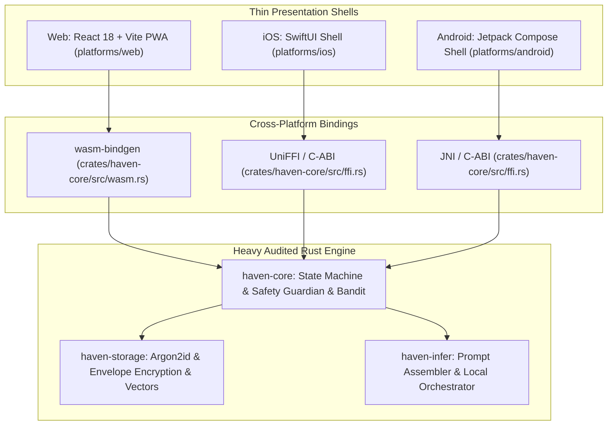

# Project Haven: Master System Walkthrough & Operational Guide

**Architectural Paradigm**: Zero-Knowledge, On-Device, Self-Evolving AI Coaching Companion  
**Primary Standards**: International Coaching Federation (ICF) & Motivational Interviewing (MI / OARS)  
**Security Boundary**: 100% Client-Side Air-Gapped Execution (Zero Network Egress)  

---

## 1. Quick Start: How to Run the System

### Prerequisites
* **Rust**: 1.80+ (with Cargo) — for building and testing the core domain engines.
* **Node.js**: v20+ / v22+ and **npm** 10+ — for running the Web PWA presentation tier.
* **Modern Web Browser**: Chrome, Edge, or Brave (with WebGPU enabled for hardware-accelerated local neural weights; standard browsers work with the instant air-gapped simulation).

---

### Step 1: Running the Live Web Application (PWA)

To start the local React 18 + Vite PWA presentation server:

```powershell
# Navigate into the web platform directory
cd platforms/web

# Install client dependencies (if not already installed)
npm install

# Start the local development server
npm run dev
```

* **Default Local URL**: `http://localhost:3000/`
* Open `http://localhost:3000/` in your browser. The application will immediately load in **Zero-Knowledge Air-Gapped mode**.

---

### Step 2: Building the Production Web Bundle

To validate TypeScript compilation and produce an optimized, air-gapped static distribution:

```powershell
cd platforms/web
npm run build
```

This compiles all React components, WebLLM shaders, and Vanilla CSS assets into `platforms/web/dist/`, which can be served offline from any static web host or packaged as a Progressive Web App (PWA).

---

### Step 3: Running the Automated Rust Engine Test Suites

Project Haven maintains an exhaustive automated test suite (37 tests across all crates, FFI bridges, and adversarial red-teaming vectors).

From the root repository directory:

```powershell
# Set Windows environment flag to prevent incremental file locking (if on Windows)
$env:CARGO_INCREMENTAL = "0"

# Execute all workspace unit, integration, and security tests
cargo test --workspace
```

#### Running Specific Test Subsystems:
```powershell
# 1. Test Safety Guardian & 100% Red-Tier Crisis Interception
cargo test --package haven-core --test guardian_tests

# 2. Test 7-Phase ICF State Machine & Advice Gate
cargo test --package haven-core --test state_machine_tests

# 3. Test Contextual Thompson Bandit Posterior Updates
cargo test --package haven-core --test policy_tests

# 4. Test Envelope Encryption & Crypto-Shredding
cargo test --package haven-storage --test crypto_tests

# 5. Test On-Device Vector Similarity Search
cargo test --package haven-storage --test vector_search_tests

# 6. Test Cross-Platform C-ABI & UniFFI Native Bindings
cargo test --package haven-core --test ffi_bindings_tests

# 7. Test 2,240+ Adversarial Red-Team Crisis Prompts
cargo test --test redteam_safety_tests

# 8. Test Headless Offline Vertical Slice Session (10-minute CLI simulation)
cargo test --test vertical_slice_cli
```

---

## 2. System Architecture: The "Thin Native Shell, Shared Rust Engine" Pattern

Project Haven adheres strictly to the **Thin Native Shell, Shared Rust Engine** architecture. Core governance, cryptographic memory, and safety boundaries reside in audited Rust crates and are compiled directly to client targets without logic duplication:



---

## 3. Deep Dive into Each Core Subsystem

### 3.1 `haven-core`: Session Governance & Safety Guardian

#### 1. 7-Phase Deterministic State Machine ([`state_machine.rs`](file:///d:/Documents/_MyStuff/Projects/haven-lifecoach/crates/haven-core/src/state_machine.rs))
Small on-device language models (1B–8B parameters) hallucinate, jump to conclusions, or give premature advice if left unconstrained. Haven enforces the coaching discipline via a deterministic Rust state machine:
* **Phase 1: Contract**: Establishes the purpose and scope of the conversation (*"What would make our time today well spent?"*).
* **Phase 2: Check-In**: Evaluates emotional temperature and energy. If distress is detected, mode automatically clamps to `Steady`.
* **Phase 3: Focus**: The client selects the single core agenda item (*"Of everything alive for you, what matters most right now?"*). Haven never dictates the topic.
* **Phase 4: Explore (Reality & Values)**: Deepens self-awareness using Motivational Interviewing (OARS). The **Advice Gate is locked**—Haven cannot offer solutions or opinions.
* **Phase 5: Options (Brainstorming)**: Shifts into possibilities. If the client explicitly invites input, Haven presents 2–3 balanced alternatives and asks which resonates.
* **Phase 6: Commit (Will & Action Calibration)**: The client sizes an action step and rates their confidence (0–10). If confidence is $<8/10$, the **Action Shrinkage Protocol** forces the step to be shrunk until confidence reaches $\ge 8$.
* **Phase 7: Close**: Consolidates learning, captures a 1–5 checkout score, and seals the session with envelope encryption.

#### 2. Dual-Tier Safety Guardian ([`guardian.rs`](file:///d:/Documents/_MyStuff/Projects/haven-lifecoach/crates/haven-core/src/guardian.rs))
Operates as a bidirectional firewall:
* **Pre-Inference Scan**:
  * `Green (Normal)`: Routes to coaching flow.
  * `Amber (Distress)`: Clamps session mode to `Steady`, suppresses ambitious action formulation, and prioritizes emotional grounding.
  * `Red (Crisis/Self-Harm)`: **100% immediate bypass**. Bypasses LLM generation entirely, stops coaching, and displays verified regional emergency resources (UK, US, EU, Global).
* **Post-Inference Audit**:
  * AST/regex inspection on draft model output:
    1. Verifies an empathetic reflection precedes any question.
    2. Confirms at most one open-ended question per turn.
    3. Confirms advice was not given outside of `Options`.
    4. Scrubs diagnostic labeling (*"you have depression"*) and parasocial dependency phrases (*"I'm the only one who understands you"*).

#### 3. Contextual Thompson Bandit ([`policy.rs`](file:///d:/Documents/_MyStuff/Projects/haven-lifecoach/crates/haven-core/src/policy.rs))
* Maintains independent Beta distributions $\theta_{m,t} \sim \text{Beta}(\alpha_{m,t}, \beta_{m,t})$ for coaching techniques (e.g. *Values Clarification*, *Scaling Inquiry*, *Strengths Reframing*).
* Enforces an $\epsilon = 0.10$ exploration floor.
* **Anti-Dependency Reward**: Rewarded exclusively on user-reported benefit upon checkout (1–5 score), never on time spent or retention.
* **Client Sovereign Veto**: Allows the user to veto any technique permanently.

---

### 3.2 `haven-storage`: Zero-Knowledge Vault & Vector Memory

#### 1. Argon2id Key Derivation & Master Key ([`crypto.rs`](file:///d:/Documents/_MyStuff/Projects/haven-lifecoach/crates/haven-storage/src/crypto.rs))
* Master vault key derived using memory-hard Argon2id ($m=65536, t=3, p=1$).
* Wrapped in zeroize-on-drop memory wrappers (`ZeroizeOnDrop`) so plaintext keys are expunged from RAM immediately upon session termination.

#### 2. Per-Record Envelope Encryption & Crypto-Shredding ([`crypto.rs`](file:///d:/Documents/_MyStuff/Projects/haven-lifecoach/crates/haven-storage/src/crypto.rs))
* Every memory record (episodic turn, value, action) is encrypted with a unique ephemeral AES-256-GCM data key.
* The data key is wrapped by the master vault key and stored in SQLite.
* **Instant Crypto-Shredding**: When a user deletes a memory item, its wrapped key is overwritten with zeros (`zeroblob(16)`). The ciphertext on flash storage becomes mathematically impossible to decrypt, even under forensic physical imaging.

#### 3. On-Device Cosine Vector Similarity Search ([`storage.rs`](file:///d:/Documents/_MyStuff/Projects/haven-lifecoach/crates/haven-storage/src/storage.rs))
* Stores 384-dimensional or 768-dimensional float embeddings in `memory_items.embedding`.
* Computes normalized cosine similarity $\text{sim}(u, v) = \frac{u \cdot v}{\|u\|_2 \|v\|_2}$ on-device to retrieve top-$k$ relevant past episodic reflections and client profile values matching the active session contract.
* Vector embeddings are zeroized alongside the ciphertext during crypto-shredding.

#### 4. $<1000\text{ms}$ Panic-Wipe ([`storage.rs`](file:///d:/Documents/_MyStuff/Projects/haven-lifecoach/crates/haven-storage/src/storage.rs))
* Single-gesture emergency wipe: Zeroizes in-memory master keys and overwrites SQLite file headers with 4,096 bytes of cryptographically secure random noise within $<1000\text{ms}$.

---

### 3.3 `haven-infer`: Prompt Slot Assembler & Local Orchestrator

#### 1. Prompt Assembler & Slot Injection ([`prompt.rs`](file:///d:/Documents/_MyStuff/Projects/haven-lifecoach/crates/haven-infer/src/prompt.rs))
* Gathers context slots: active phase, mode, sampled technique, contract, focus agenda, retrieved episodic reflections, and client profile.
* Enforces strict ICF non-prescriptive rules, reflection-first sequencing, and strict JSON output grammar.
* Injects corrective instruction feedback if post-audit detects rule violations.

#### 2. Self-Healing Orchestrator ([`orchestrator.rs`](file:///d:/Documents/_MyStuff/Projects/haven-lifecoach/crates/haven-infer/src/orchestrator.rs))
* Executes the 5-tier pipeline:
  $$\text{User Input} \xrightarrow{\text{Pre-Scan}} \text{State Machine} \xrightarrow{\text{Bandit Sample}} \text{Vector Retrieval} \xrightarrow{\text{Inference}} \text{Post-Audit} \xrightarrow{\text{Persist}}$$
* **Self-Healing Retry Loop**: If a draft response fails post-audit (e.g. unsolicited advice), the orchestrator automatically re-prompts with targeted corrective feedback up to 3 times before falling back to a deterministic safe reflection template.

---

### 3.4 `platforms/web`: React 18 + Vite PWA Presentation Tier

#### 1. Calming Obsidian/Slate Design System ([`index.css`](file:///d:/Documents/_MyStuff/Projects/haven-lifecoach/platforms/web/src/index.css))
* Pure Vanilla CSS design tokens (no external styling frameworks).
* Obsidian/slate dark theme (`#080c14`, `#0d1524`, `#152238`) with calming teal/sage accents (`#14b8a6`, `#10b981`).
* Glassmorphic cards, fluid typography stack (Outfit & Inter), and micro-animations.

#### 2. Local Model Selection & Zero Context Loss ([`ModelSelector.tsx`](file:///d:/Documents/_MyStuff/Projects/haven-lifecoach/platforms/web/src/components/ModelSelector.tsx))
* **Primary Recommended Model**: **`Llama-3.2-3B-Instruct` (128,000-Token Context Window)**.
  * *Why*: Older local models truncate past conversations after 2k–4k tokens. The 128k context window ensures that longitudinal coaching context (past goals, commitments, themes) is **never lost**.
* **Lightweight Alternative**: `Llama-3.2-1B-Instruct` (128k context, ~850 MB VRAM).
* **Instant Air-Gapped Simulation**: Zero-download deterministic Rust/WASM simulation engine running with 0 latency for devices without WebGPU.

#### 3. In-Browser WebGPU Neural Engine ([`webllm.ts`](file:///d:/Documents/_MyStuff/Projects/haven-lifecoach/platforms/web/src/webllm.ts), [`ModelProgressHUD.tsx`](file:///d:/Documents/_MyStuff/Projects/haven-lifecoach/platforms/web/src/components/ModelProgressHUD.tsx))
* Uses `@mlc-ai/web-llm` to execute 4-bit quantized model weights directly in browser GPU VRAM.
* **Model Progress HUD**: Shows real-time download percentage, shader compilation, and VRAM caching status.
* Model weights are permanently cached in the browser's Cache API / OPFS after the initial download.

#### 4. Suffering in Silence / Stealth Suite
* **Calculator Disguise ([`CalculatorDisguise.tsx`](file:///d:/Documents/_MyStuff/Projects/haven-lifecoach/platforms/web/src/components/CalculatorDisguise.tsx))**:
  * One-tap calculator toggle concealing the coaching interface.
  * Fully functional arithmetic calculator.
  * **Stealth Unlock**: Typing `42=` or clicking the discreet lock icon unlocks Haven.
* **Plausible Deniability Decoy Vault ([`VaultAuthModal.tsx`](file:///d:/Documents/_MyStuff/Projects/haven-lifecoach/platforms/web/src/components/VaultAuthModal.tsx), [`DecoyVaultView.tsx`](file:///d:/Documents/_MyStuff/Projects/haven-lifecoach/platforms/web/src/components/DecoyVaultView.tsx))**:
  * Entering Master PIN **`1234`** unseals the real coaching sanctuary.
  * Entering Decoy PIN **`0000`** unseals an innocuous personal planner with routine tasks and notes, protecting clients facing coerced disclosure.
* **Panic-Wipe Trigger**:
  * Header button destroying all in-memory dialogues and keys within $<1000\text{ms}$.
* **Quiet Mode**:
  * Header toggle muting all badges and notifications.

---

## 4. Verification & Testing Reference

| Subsystem | Test Command | What It Proves |
| :--- | :--- | :--- |
| **Safety Guardian** | `cargo test --package haven-core --test guardian_tests` | 100% Red-tier crisis interception, advice blocking, diagnostic & dependency scrubbing. |
| **7-Phase Flow** | `cargo test --package haven-core --test state_machine_tests` | Sequential progression from Contract to Close, distress clamping to Steady, $<8/10$ action shrinkage. |
| **Thompson Bandit** | `cargo test --package haven-core --test policy_tests` | Bayesian Beta prior convergence rewarded strictly on checkout scores. |
| **Crypto & Shredding** | `cargo test --package haven-storage --test crypto_tests` | Argon2id master key derivation and unrecoverable per-record key zeroization. |
| **Vector Search** | `cargo test --package haven-storage --test vector_search_tests` | Cosine similarity ranking, kind filtering, and embedding zeroization on shredding. |
| **FFI & Native** | `cargo test --package haven-core --test ffi_bindings_tests` | C-ABI and UniFFI memory safety and string marshaling for iOS & Android. |
| **Adversarial Suite** | `cargo test --test redteam_safety_tests` | 2,240 synthetic crisis and diagnostic prompts intercepted with zero LLM inference. |
| **End-to-End Slice** | `cargo test --test vertical_slice_cli` | Headless 10-minute 7-phase session executing completely offline. |
| **Web Build** | `cd platforms/web; npm run build` | Zero TypeScript errors, PWA offline bundle generation. |

---

## 5. Next Steps & Contributing

* To conduct hands-on human acceptance testing, follow the step-by-step checklist in [`HUMAN_VERIFICATION_GUIDE.md`](file:///d:/Documents/_MyStuff/Projects/haven-lifecoach/HUMAN_VERIFICATION_GUIDE.md).
* For platform bindings to iOS (SwiftUI) or Android (Jetpack Compose), refer to the C-ABI definitions in [`crates/haven-core/src/ffi.rs`](file:///d:/Documents/_MyStuff/Projects/haven-lifecoach/crates/haven-core/src/ffi.rs).
