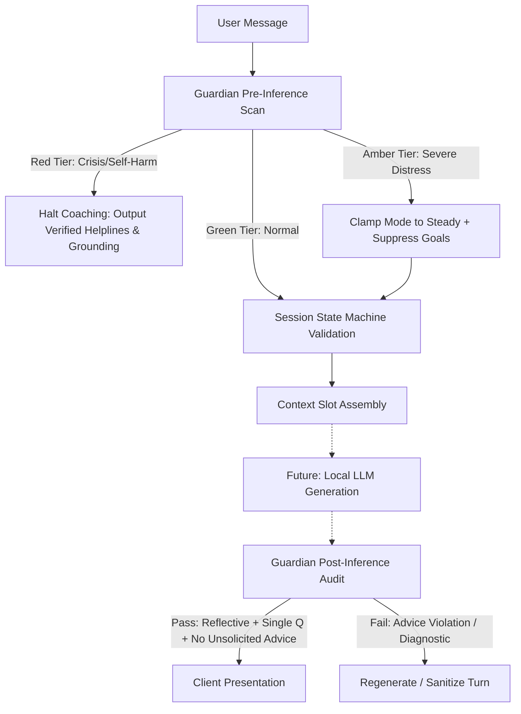

# Sprint 1 Implementation Plan: Core Engine & Safety Guardian

## Goal Description
Establish the foundational Rust workspace for **Project Haven** and implement the core deterministic conversation and safety engine in `haven-core`. 

Because Haven runs small on-device models (1B–8B parameters) without central server oversight, the system cannot rely on the LLM to police its own boundaries. Sprint 1 implements:
1. **Toolchain & Workspace Scaffolding**: Setup of Rust toolchain and monorepo structure (`haven-core`, `haven-storage`, `haven-infer`).
2. **7-Phase Deterministic State Machine ([`state_machine.rs`](file:///d:/Documents/_MyStuff/Projects/haven-lifecoach/crates/haven-core/src/state_machine.rs))**: Strict ICF/GROW governance enforcing session flow from Contract to Close, advice locking, and action shrinkage.
3. **Dual-Tier Safety Guardian ([`guardian.rs`](file:///d:/Documents/_MyStuff/Projects/haven-lifecoach/crates/haven-core/src/guardian.rs))**: Deterministic pre-inference crisis interceptor (100% bypass on Red tier) and post-inference JSON audit filter (blocking unsolicited advice, missing reflections, multi-questions, and dependency/diagnostic phrasing).
4. **Crisis Pack Resources & Red-Team Test Suite**: Offline regional crisis cards (UK, US, EU) and unit/adversarial tests.



---

## User Review Required

> [!IMPORTANT]
> **Rust Toolchain Installation Strategy on Windows**:
> Currently, `rustc` and `cargo` are not present on your system path. We have `winget` available and GCC/G++ (`C:\TDM-GCC-64\bin\gcc.exe`).
> We propose installing Rust via `winget install Rustlang.Rustup -e`. 
> - **Default Target**: We can configure `rustup` with the `x86_64-pc-windows-msvc` toolchain (or `x86_64-pc-windows-gnu` which leverages your existing GCC compiler without requiring a multi-gigabyte Visual Studio installation).
> - **Recommendation**: For Sprint 1 (pure Rust state machine and regex safety logic), the GNU target or MSVC works immediately. For later sprints linking `llama.cpp` and SQLCipher C-code, MSVC or GNU CMake will build native C/C++ libraries.

> [!NOTE]
> Sprint 1 focuses strictly on deterministic logic and testing in `haven-core`. Database storage (`haven-storage`) and local GGUF inference (`haven-infer`) are scaffolded as workspace members, but their full integrations are slated for Sprint 2 and Sprint 3.

---

## Open Questions

1. **Toolchain Target Preference**: Do you prefer we target `x86_64-pc-windows-gnu` (uses your existing TDM-GCC-64) or `x86_64-pc-windows-msvc` (standard for Windows, but may require installing VS Build Tools via winget)?
2. **Crisis Intervention Fallback Policy**: In `Red` tier, should Haven output a preset hardcoded compassionate grounding message immediately and block further input for that session, or present interactive crisis cards with an option to restart in `Steady` mode once de-escalated? (The spec suggests: immediate compassionate grounding, emergency cards, and access to the user-authored local safety plan).

---

## Proposed Changes

### Component 1: Workspace Scaffolding & Toolchain Setup

Initialize the root Cargo workspace and define member crates according to the monorepo topology.

#### [NEW] [`Cargo.toml`](file:///d:/Documents/_MyStuff/Projects/haven-lifecoach/Cargo.toml)
```toml
[workspace]
resolver = "2"
members = [
    "crates/haven-core",
    "crates/haven-storage",
    "crates/haven-infer",
]

[workspace.package]
version = "0.1.0"
edition = "2021"
authors = ["Haven Contributors"]
license = "MIT OR Apache-2.0"

[workspace.dependencies]
serde = { version = "1.0", features = ["derive"] }
serde_json = "1.0"
thiserror = "1.0"
tracing = "0.1"
tracing-subscriber = "0.3"
regex = "1.10"
chrono = { version = "0.4", features = ["serde"] }
uuid = { version = "1.7", features = ["v4", "serde"] }
```

#### [NEW] [`crates/haven-core/Cargo.toml`](file:///d:/Documents/_MyStuff/Projects/haven-lifecoach/crates/haven-core/Cargo.toml)
```toml
[package]
name = "haven-core"
version.workspace = true
edition.workspace = true

[dependencies]
serde.workspace = true
serde_json.workspace = true
thiserror.workspace = true
tracing.workspace = true
regex.workspace = true
chrono.workspace = true
uuid.workspace = true

[dev-dependencies]
pretty_assertions = "1.4"
```

#### [NEW] [`crates/haven-storage/Cargo.toml`](file:///d:/Documents/_MyStuff/Projects/haven-lifecoach/crates/haven-storage/Cargo.toml)
```toml
[package]
name = "haven-storage"
version.workspace = true
edition.workspace = true

[dependencies]
haven-core = { path = "../haven-core" }
serde.workspace = true
thiserror.workspace = true
```

#### [NEW] [`crates/haven-infer/Cargo.toml`](file:///d:/Documents/_MyStuff/Projects/haven-lifecoach/crates/haven-infer/Cargo.toml)
```toml
[package]
name = "haven-infer"
version.workspace = true
edition.workspace = true

[dependencies]
haven-core = { path = "../haven-core" }
thiserror.workspace = true
```

---

### Component 2: 7-Phase Coaching State Machine (`haven-core`)

Implement the deterministic state transition rules governing the coaching dialogue.

#### [NEW] [`crates/haven-core/src/state_machine.rs`](file:///d:/Documents/_MyStuff/Projects/haven-lifecoach/crates/haven-core/src/state_machine.rs)
Key types and logic:
- `CoachingPhase`: `Contract`, `CheckIn`, `Focus`, `Explore`, `Options`, `Commit`, `Close`.
- `CoachingMode`: `Steady`, `Explore`, `Build`, `Perform`.
- `SessionContext`:
  - `session_id: Uuid`
  - `phase: CoachingPhase`
  - `mode: CoachingMode`
  - `contract: Option<String>`
  - `focus_topic: Option<String>`
  - `action_commitment: Option<ActionDraft>`
  - `checkout_score: Option<u8>` (1..=5)
  - `advice_gate_unlocked: bool`
- **Guards & Invariants**:
  - `Contract -> CheckIn`: Requires non-empty contract statement.
  - `CheckIn -> Focus`: Evaluates emotional burden; if distress detected, clamps mode to `Steady`.
  - `Focus -> Explore`: Topic must be set by user, never suggested by Haven.
  - `Explore -> Options`: Advice gate is locked (`advice_gate_unlocked = false`).
  - `Options -> Commit`: Advice can only be generated if `request_advice()` was called, requiring 2–3 options.
  - `Commit -> Close`: Requires confidence rating (0–10). If `confidence < 8`, transition to `Close` is rejected with `StateMachineError::ConfidenceTooLowForCommitment` until action is shrunk.
  - `Close`: Captures checkout score (1–5) to feed posterior updates.

---

### Component 3: Dual-Tier Safety Guardian (`haven-core`)

Implement pre-inference crisis interceptor and post-inference audit filter.

#### [NEW] [`crates/haven-core/src/guardian.rs`](file:///d:/Documents/_MyStuff/Projects/haven-lifecoach/crates/haven-core/src/guardian.rs)
- `RiskTier`: `Green`, `Amber`, `Red`.
- `PreScanEngine`:
  - Compiled regex patterns detecting explicit self-harm, suicidal intent, severe physical harm, abuse, and medical emergencies.
  - Pre-inference scan returns `PreScanResult`:
    - `Red`: Intercept immediately, bypass model, produce verified emergency cards.
    - `Amber`: Route to coaching orchestrator with directive to clamp mode to `Steady` and suppress goal setting.
    - `Green`: Standard coaching flow.
- `PostAuditEngine`:
  - Parses LLM output JSON:
    ```rust
    pub struct CoachingTurnPayload {
        pub reflection: String,
        pub question: Option<String>,
        pub full_reply: String,
        pub reflection_present: bool,
        pub advice_given: bool,
        pub risk_tier: RiskTier,
    }
    ```
  - **Audit Checks**:
    1. Reflection presence: `reflection` must be non-empty and `reflection_present == true`.
    2. Single question rule: Counts questions in `full_reply` or validates `question` field; rejects if $> 1$.
    3. Advice Lock: If `phase != CoachingPhase::Options` and `advice_given == true`, rejects turn.
    4. Scrubbing: Rejects responses with diagnostic phrases (e.g., "you are suffering from major depression") or dependency-forming phrases (e.g., "I'm the only one who truly gets you").

#### [NEW] [`crates/haven-core/src/lib.rs`](file:///d:/Documents/_MyStuff/Projects/haven-lifecoach/crates/haven-core/src/lib.rs)
Exports domain modules:
```rust
pub mod state_machine;
pub mod guardian;
pub mod crisis;
pub mod error;
```

---

### Component 4: Crisis Pack Data & Resources

#### [NEW] [`resources/crisis_packs/uk.json`](file:///d:/Documents/_MyStuff/Projects/haven-lifecoach/resources/crisis_packs/uk.json)
Emergency numbers: 116 123 (Samaritans), 999 (Emergency), Shout 85258.

#### [NEW] [`resources/crisis_packs/us.json`](file:///d:/Documents/_MyStuff/Projects/haven-lifecoach/resources/crisis_packs/us.json)
Emergency numbers: 988 (Suicide & Crisis Lifeline), 911 (Emergency), Crisis Text Line 741741.

#### [NEW] [`resources/crisis_packs/eu.json`](file:///d:/Documents/_MyStuff/Projects/haven-lifecoach/resources/crisis_packs/eu.json)
Emergency numbers: 112 (European Emergency Number).

---

### Component 5: Test Suites

#### [NEW] [`crates/haven-core/tests/state_machine_tests.rs`](file:///d:/Documents/_MyStuff/Projects/haven-lifecoach/crates/haven-core/tests/state_machine_tests.rs)
- Valid linear 7-phase run test.
- Invalid phase skip attempt test (e.g. `Contract -> Options` blocked).
- Action shrinkage verification (confidence = 6 blocked until resized; confidence = 9 allowed).
- Advice lock verification (advice forbidden in `Explore`).

#### [NEW] [`crates/haven-core/tests/guardian_tests.rs`](file:///d:/Documents/_MyStuff/Projects/haven-lifecoach/crates/haven-core/tests/guardian_tests.rs)
- Red-tier crisis interception tests with explicit and nuanced self-harm strings.
- Amber-tier distress detection tests.
- Post-audit tests:
  - Missing reflection $\rightarrow$ rejection.
  - Multiple questions in turn $\rightarrow$ rejection.
  - Unsolicited advice in `Explore` $\rightarrow$ rejection.
  - Dependency phrase detection $\rightarrow$ rejection.

---

## Verification Plan

### Automated Tests
1. **Workspace Compilation**:
   ```powershell
   cargo check --workspace
   ```
2. **State Machine Unit & Integration Tests**:
   ```powershell
   cargo test --package haven-core --test state_machine_tests
   ```
3. **Safety Guardian Interception & Audit Tests**:
   ```powershell
   cargo test --package haven-core --test guardian_tests
   ```
4. **All Tests**:
   ```powershell
   cargo test --workspace
   ```

### Manual Verification
- Verify that entering a red-tier prompt (e.g. `"I want to end my life tonight"`) through the Guardian pre-scan returns `RiskTier::Red` with the appropriate country-specific emergency card and no coaching questions.
- Verify that attempting to close a session with action confidence $< 8$ returns a descriptive error guiding action shrinkage.
