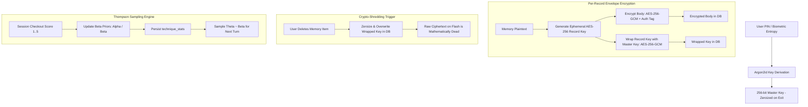

# Sprint 2 Implementation Plan: Cryptographic Storage & Bandit Engine

## Goal Description
Implement the zero-knowledge persistence layer in `haven-storage` and the self-evolving adaptation engine in `haven-core`:
1. **Cryptographic Engine & Per-Record Shredding ([`crypto.rs`](file:///d:/Documents/_MyStuff/Projects/haven-lifecoach/crates/haven-storage/src/crypto.rs))**:
   - Master key derivation from user PIN/passkey and salt using **Argon2id**.
   - Per-record **AES-256-GCM envelope encryption**: each memory item has a unique ephemeral data key (`record_key`) wrapped by the master vault key (`record_key_wrapped`).
   - **Crypto-Shredding**: zeroizing/destroying `record_key_wrapped` renders the stored ciphertext on flash memory permanently and mathematically undecipherable.
2. **Encrypted Relational Persistence ([`schema.rs`](file:///d:/Documents/_MyStuff/Projects/haven-lifecoach/crates/haven-storage/src/schema.rs), [`storage.rs`](file:///d:/Documents/_MyStuff/Projects/haven-lifecoach/crates/haven-storage/src/storage.rs))**:
   - Embedded database manager executing migrations for `sessions`, `memory_items`, `actions`, and `technique_stats`.
   - Tripartite memory storage interface (Episodic, Semantic, Procedural).
3. **Thompson Sampling Contextual Bandit ([`policy.rs`](file:///d:/Documents/_MyStuff/Projects/haven-lifecoach/crates/haven-core/src/policy.rs))**:
   - Mathematical Beta distribution sampling ($\theta_{m,t} \sim \text{Beta}(\alpha_{m,t}, \beta_{m,t})$).
   - $\epsilon = 0.10$ exploration floor.
   - Posterior Bayesian update driven exclusively by user checkout ratings (1–5) and one-tap feedback.
   - User technique veto management.
4. **Project Changelog Maintenance**:
   - Create and maintain root [`CHANGELOG.md`](file:///d:/Documents/_MyStuff/Projects/haven-lifecoach/CHANGELOG.md) documenting Sprint 1 achievements and Sprint 2 milestones.



---

## User Review Required

> [!IMPORTANT]
> **Database Engine Configuration**:
> - We will use `rusqlite` with the `bundled` feature for the core SQL engine, which provides full relational integrity, ACID transactions, and zero-external-dependency builds with MinGW-w64 on Windows.
> - At the data layer, full envelope encryption (Argon2id + AES-256-GCM) is applied to all sensitive memory rows with per-record key wrapping.
> - An optional feature flag `sqlcipher` will be defined in `haven-storage/Cargo.toml` for platforms linking full database-level page encryption.

> [!NOTE]
> **Anti-Dependency Constraint**:
> As specified in [HAVEN_AGENT_SPEC.md](file:///d:/Documents/_MyStuff/Projects/haven-lifecoach/HAVEN_AGENT_SPEC.md), the Thompson sampling policy is rewarded *exclusively* on user-reported checkout benefit (1–5) and explicit technique feedback, *never* on time spent, daily streaks, or retention metrics.

---

## Open Questions

1. **Checkout Score Update Mapping**:
   - Proposed mapping:
     - Score `5` or `4` ("That helped") $\rightarrow \alpha \leftarrow \alpha + 1$ (helpful)
     - Score `1` or `2` ("Not quite") $\rightarrow \beta \leftarrow \beta + 1$ (unhelpful)
     - Score `3` (Neutral) $\rightarrow$ No parameter change.
   - Does this match your intended weighting for technique reinforcement?
2. **Panic-Wipe Scope in Sprint 2**:
   - Would you like Sprint 2 to include the foundation for the 1-second `panic_wipe()` helper in `haven-storage` (which overwrites database headers and zeroizes master keys immediately)?

---

## Proposed Changes

### Component 1: Project Changelog & Workspace Dependencies

#### [NEW] [`CHANGELOG.md`](file:///d:/Documents/_MyStuff/Projects/haven-lifecoach/CHANGELOG.md)
Document completed Sprint 1 deliverables (State Machine, Dual-tier Guardian, Crisis packs) and Sprint 2 deliverables.

#### [MODIFY] [`Cargo.toml`](file:///d:/Documents/_MyStuff/Projects/haven-lifecoach/Cargo.toml)
Add cryptographic and statistical dependencies to `workspace.dependencies`:
```toml
argon2 = "0.5"
aes-gcm = "0.10"
zeroize = { version = "1.8", features = ["derive"] }
rand = "0.8"
rand_distr = "0.4"
rusqlite = { version = "0.31", features = ["bundled"] }
```

#### [MODIFY] [`crates/haven-core/Cargo.toml`](file:///d:/Documents/_MyStuff/Projects/haven-lifecoach/crates/haven-core/Cargo.toml)
Add `rand` and `rand_distr` dependencies for Thompson sampling.

#### [MODIFY] [`crates/haven-storage/Cargo.toml`](file:///d:/Documents/_MyStuff/Projects/haven-lifecoach/crates/haven-storage/Cargo.toml)
Add `argon2`, `aes-gcm`, `zeroize`, `rusqlite`, `rand`, and `uuid`.

---

### Component 2: Thompson Sampling Policy Engine (`haven-core`)

#### [NEW] [`crates/haven-core/src/policy.rs`](file:///d:/Documents/_MyStuff/Projects/haven-lifecoach/crates/haven-core/src/policy.rs)
Key types and algorithms:
- `CoachingTechnique`:
  - `ValuesClarification`
  - `ScalingInquiry`
  - `StrengthsReframing`
  - `MicroStepBreakdown`
  - `PerspectiveShift`
  - `ExceptionSeeking`
  - `GroundingBreath`
- `TechniqueStats`:
  - `mode: CoachingMode`
  - `technique: CoachingTechnique`
  - `alpha: f64` (default 1.0)
  - `beta: f64` (default 1.0)
  - `vetoed: bool`
- `ThompsonBandit`:
  - `exploration_floor: 0.10` ($\epsilon$)
  - `select_technique(mode: CoachingMode, allowed: &[CoachingTechnique]) -> CoachingTechnique`:
    - Samples $\theta \sim \text{Beta}(\alpha, \beta)$ for each non-vetoed technique.
    - With probability $\epsilon = 0.10$: Uniform random selection.
    - With probability $1 - \epsilon$: $\text{argmax}(\theta)$.
  - `update_posterior(mode: CoachingMode, technique: CoachingTechnique, helpful: bool)`:
    - Increments $\alpha$ if helpful, increments $\beta$ if unhelpful.
  - `set_veto(mode: CoachingMode, technique: CoachingTechnique, vetoed: bool)`

#### [MODIFY] [`crates/haven-core/src/lib.rs`](file:///d:/Documents/_MyStuff/Projects/haven-lifecoach/crates/haven-core/src/lib.rs)
Export `policy` module, `CoachingTechnique`, `TechniqueStats`, and `ThompsonBandit`.

---

### Component 3: Cryptographic Engine & Crypto-Shredding (`haven-storage`)

#### [NEW] [`crates/haven-storage/src/crypto.rs`](file:///d:/Documents/_MyStuff/Projects/haven-lifecoach/crates/haven-storage/src/crypto.rs)
- `MasterVaultKey`: 256-bit key protected with `ZeroizeOnDrop`.
- `derive_master_key(pin: &str, salt: &[u8]) -> Result<MasterVaultKey, StorageError>`:
  - Uses Argon2id (m_cost=65536, t_cost=3, p_cost=4, 32-byte output).
- `EnvelopeEncryptedPayload`:
  - `ciphertext: Vec<u8>` (AES-256-GCM encrypted data)
  - `nonce: [u8; 12]`
  - `wrapped_record_key: Vec<u8>` (AES-256-GCM wrapped data key)
  - `wrapped_key_nonce: [u8; 12]`
- `encrypt_memory_record(master_key: &MasterVaultKey, plaintext: &[u8]) -> Result<EnvelopeEncryptedPayload, StorageError>`:
  - Generates ephemeral random 256-bit `record_key`.
  - Encrypts `plaintext` with `record_key`.
  - Wraps `record_key` with `master_key`.
  - Zeroizes plaintext `record_key` from RAM.
- `decrypt_memory_record(master_key: &MasterVaultKey, payload: &EnvelopeEncryptedPayload) -> Result<Vec<u8>, StorageError>`:
  - Unwraps `record_key` using `master_key`.
  - Decrypts `ciphertext` using `record_key`.
  - Zeroizes unwrapped `record_key`.
- `shred_wrapped_key(wrapped_key: &mut [u8])`:
  - Securely overwrites wrapped key buffer with zeroes or cryptographically random bytes.

---

### Component 4: Storage Manager & Relational Database (`haven-storage`)

#### [NEW] [`crates/haven-storage/src/schema.rs`](file:///d:/Documents/_MyStuff/Projects/haven-lifecoach/crates/haven-storage/src/schema.rs)
- SQL migrations matching spec:
  - `sessions` table
  - `memory_items` table (`kind`, `body` [encrypted ciphertext], `record_key_wrapped`, `importance`, etc.)
  - `actions` table
  - `technique_stats` table

#### [NEW] [`crates/haven-storage/src/storage.rs`](file:///d:/Documents/_MyStuff/Projects/haven-lifecoach/crates/haven-storage/src/storage.rs)
- `HavenStorage`:
  - `open_in_memory(master_key: MasterVaultKey) -> Result<Self, StorageError>`
  - `open_at_path(path: &Path, master_key: MasterVaultKey) -> Result<Self, StorageError>`
  - Session operations: `save_session(&self, summary: &SessionSummary)`, `load_session(&self, id: Uuid)`.
  - Action operations: `save_action(&self, action: &ActionCommitment, session_id: Uuid)`, `list_actions(&self)`.
  - Memory operations:
    - `insert_memory(&self, kind: MemoryKind, plaintext: &str) -> Result<Uuid, StorageError>`
    - `get_memory(&self, id: Uuid) -> Result<String, StorageError>`
    - `crypto_shred_memory(&self, id: Uuid) -> Result<(), StorageError>` (overwrites wrapped key with 0s)
  - Bandit stats operations:
    - `load_technique_stats(&self) -> Result<Vec<TechniqueStats>, StorageError>`
    - `save_technique_stats(&self, stats: &[TechniqueStats]) -> Result<(), StorageError>`
  - Panic wipe:
    - `panic_wipe(&mut self) -> Result<(), StorageError>` (zeroizes keys and scrambles file header)

#### [NEW] [`crates/haven-storage/src/error.rs`](file:///d:/Documents/_MyStuff/Projects/haven-lifecoach/crates/haven-storage/src/error.rs)
- `StorageError`: `CryptoError`, `DecryptionFailed`, `DatabaseError`, `RecordNotFound`, etc.

---

### Component 5: Tests & Verification

#### [NEW] [`crates/haven-core/tests/policy_tests.rs`](file:///d:/Documents/_MyStuff/Projects/haven-lifecoach/crates/haven-core/tests/policy_tests.rs)
- Thompson sampling distribution test: Verify technique selection with convergence toward higher-alpha techniques.
- Exploration floor test: Verify ~10% uniform sampling under extreme alpha/beta asymmetry.
- Veto test: Verify vetoed techniques are never selected.
- Bayesian update test: Verify posterior $\alpha$ and $\beta$ increments.

#### [NEW] [`crates/haven-storage/tests/crypto_tests.rs`](file:///d:/Documents/_MyStuff/Projects/haven-lifecoach/crates/haven-storage/tests/crypto_tests.rs)
- Argon2id deterministic derivation and wrong PIN rejection test.
- Encryption & decryption roundtrip test.
- **Crypto-Shredding Test**: Verify that zeroizing `record_key_wrapped` causes decryption to fail definitively with `StorageError::DecryptionFailed`.

#### [NEW] [`crates/haven-storage/tests/storage_integration_tests.rs`](file:///d:/Documents/_MyStuff/Projects/haven-lifecoach/crates/haven-storage/tests/storage_integration_tests.rs)
- Full database workflow: initialize DB $\rightarrow$ save session $\rightarrow$ record actions $\rightarrow$ store encrypted memory $\rightarrow$ retrieve decrypted $\rightarrow$ shred memory $\rightarrow$ verify shredded item unrecoverable.
- Technique stats persistence and sync with `ThompsonBandit`.

---

## Verification Plan

### Automated Tests
1. **Compilation Check**:
   ```powershell
   cargo check --workspace
   ```
2. **Bandit Policy Unit Tests**:
   ```powershell
   cargo test --package haven-core --test policy_tests
   ```
3. **Crypto & Shredding Tests**:
   ```powershell
   cargo test --package haven-storage --test crypto_tests
   ```
4. **Storage Integration Tests**:
   ```powershell
   cargo test --package haven-storage --test storage_integration_tests
   ```
5. **Full Workspace Test Suite**:
   ```powershell
   cargo test --workspace
   ```

### Manual Verification
- Inspect SQLite database file directly with standard tools to verify that plaintext memory bodies and raw record keys are completely unreadable (encrypted ciphertext blobs).
- Verify that calling `crypto_shred_memory()` permanently wipes the wrapped key from SQLite flash storage.
