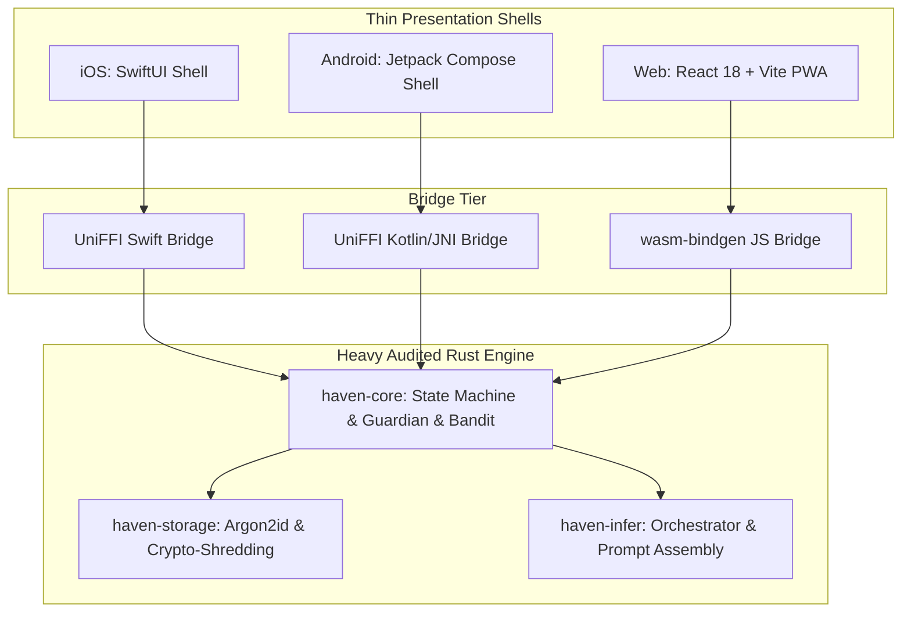

# Sprint 4 Implementation Plan: Platform Bindings & Cross-Platform Client Scaffold

## Goal Description
Bridge the audited Rust engine (`haven-core`, `haven-storage`, `haven-infer`) to client platforms following the **"Thin Native Shell, Shared Rust Engine"** architectural pattern:
1. **Cross-Platform UniFFI Native Bindings**:
   - Expose core session governance, safety classifications, encrypted storage, and contextual bandit techniques to iOS (Swift) and Android (Kotlin).
2. **WebAssembly Compilation (`wasm32-unknown-unknown`)**:
   - Compile domain logic and safety guardrails to WASM via `wasm-bindgen` for air-gapped browser execution.
3. **React 18 + Vite PWA Client Presentation Tier ([`platforms/web/`](file:///d:/Documents/_MyStuff/Projects/haven-lifecoach/platforms/web)):
   - A state-of-the-art, calm, glassmorphic client interface built with pure Vanilla CSS tokens, fluid micro-animations, and modern typography (Inter/Outfit).
   - Complete 7-phase coaching dialogue experience (Contract $\rightarrow$ Close).
   - Interactive action confidence scoring with automatic action shrinkage guidance when confidence $<8/10$.
   - One-tap session checkout scoring (1–5) and technique feedback.
   - **Suffering in Silence / Stealth Suite**:
     - *Quiet Mode*: Complete suppression of system notifications and badging.
     - *Disguise Mode*: Instant toggle disguising Haven as a clean "Calculator" or "Notes" utility.
     - *Decoy Vault*: Secondary PIN unlocking a clean decoy instance.
     - *Panic-Wipe Gesture*: 1000ms panic button triggering instant in-memory key destruction and database header scrambling.
4. **Offline Web Inference Harness**:
   - WebGPU / WebLLM client integration connecting local client hardware to the WASM-compiled Haven orchestrator.
5. **Changelog & Version Control**:
   - Update [`CHANGELOG.md`](file:///d:/Documents/_MyStuff/Projects/haven-lifecoach/CHANGELOG.md) and isolate Sprint 4 aspects into atomic commits on `develop`.



---

## User Review Required

> [!IMPORTANT]
> **PWA & WebAssembly Architecture**:
> - The Web platform will run the Rust domain logic directly in the browser via `wasm-bindgen`.
> - For storage in the browser, sensitive data is protected via the same Argon2id + AES-256-GCM envelope encryption scheme, persisting to local encrypted storage (`IndexedDB` / `Origin Private File System`).
> - The web application will be created in `platforms/web` using Vite + React.

> [!NOTE]
> **Stealth Suite Verification**:
> The Stealth Suite requires client-side triggers:
> 1. Disguise mode header button to swap the active view to a working Calculator or Notes interface.
> 2. Panic-wipe button to trigger instantaneous cryptographic erasure and redirect to the disguised view.

---

## Model Selection Strategy (User Approved)

- **Primary Context-Preserving Model (Recommended)**:
  - **Llama-3.2-3B-Instruct (128k Context Window)**: Formatted for WebGPU / WebLLM / GGUF on-device execution. The 128k context window is specifically selected so the user **never loses context** across multi-phase, longitudinal coaching journeys, maintaining full recall of past commitments, agenda evolutions, and behavioral insights.
- **Alternative Client Modes**:
  - **Llama-3.2-1B-Instruct (128k Context)**: Rapid, low-VRAM alternative for mobile or constrained devices while maintaining the full 128k context capacity.
  - **Phi-3.5-mini-instruct (128k Context)**: High-reasoning 3.8B alternative.
  - **Zero-Download Offline Simulation**: Instant, deterministic air-gapped fallback for environments without WebGPU hardware acceleration.

---

## Proposed Changes

### Component 1: Cross-Platform FFI Bindings (`crates/haven-core/src/ffi.rs`)

#### [NEW] [`crates/haven-core/src/ffi.rs`](file:///d:/Documents/_MyStuff/Projects/haven-lifecoach/crates/haven-core/src/ffi.rs)
- Export C-compatible and WASM-compatible interface wrappers:
  - `haven_session_new(mode: &str) -> Handle`
  - `haven_session_advance(handle, next_phase: &str) -> Result`
  - `haven_guardian_pre_scan(input: &str, region: &str) -> FfiPreScanResult`
  - `haven_guardian_post_audit(phase: &str, raw_json: &str) -> FfiAuditResult`
  - `haven_bandit_select_technique(mode: &str) -> String`
  - `haven_bandit_record_feedback(mode: &str, technique: &str, helpful: bool)`

---

### Component 2: WebAssembly Export (`crates/haven-core/src/wasm.rs`)

#### [NEW] [`crates/haven-core/src/wasm.rs`](file:///d:/Documents/_MyStuff/Projects/haven-lifecoach/crates/haven-core/src/wasm.rs)
- Compiles with `wasm-bindgen` when targeting `wasm32-unknown-unknown`:
  - JavaScript-friendly structs: `WasmHavenEngine`, `WasmSessionState`, `WasmPreScanResult`.
  - Enables direct execution in web browser runtimes without backend servers.

---

### Component 3: React 18 + Vite PWA (`platforms/web/`)

#### [NEW] [`platforms/web/package.json`](file:///d:/Documents/_MyStuff/Projects/haven-lifecoach/platforms/web/package.json)
- React 18, Vite, Lucide-react (minimal icons), TypeScript.

#### [NEW] [`platforms/web/index.html`](file:///d:/Documents/_MyStuff/Projects/haven-lifecoach/platforms/web/index.html)
- SEO tags, viewport configuration, manifest link, theme colors.

#### [NEW] [`platforms/web/src/index.css`](file:///d:/Documents/_MyStuff/Projects/haven-lifecoach/platforms/web/src/index.css)
- Curated design system tokens:
  - Deep reflective obsidian/slate color palette with calming sage and teal accents.
  - Glassmorphic panels with subtle backdrop blur.
  - Modern typography: Outfit / Inter typography stack.
  - Smooth micro-interactions, responsive mobile-first layout.

#### [NEW] [`platforms/web/src/App.tsx`](file:///d:/Documents/_MyStuff/Projects/haven-lifecoach/platforms/web/src/App.tsx)
- Top bar with Quiet Mode, Disguise Mode toggle, and Panic-Wipe trigger.
- 7-Phase Coaching Session Component:
  - Visual phase timeline indicator (`Contract` $\rightarrow$ `CheckIn` $\rightarrow$ `Focus` $\rightarrow$ `Explore` $\rightarrow$ `Options` $\rightarrow$ `Commit` $\rightarrow$ `Close`).
  - Active Mode badge (`Steady`, `Explore`, `Build`, `Perform`).
  - Dialogue thread rendering empathetic reflections distinctly from coaching inquiries.
  - Action Formulation widget: confidence score slider (0–10) with automatic action shrinkage warning when score $<8/10$.
  - Session Close widget: one-tap 1–5 checkout score and technique feedback.
- Crisis Card Modal:
  - Automatic popup upon Red-tier pre-scan detection displaying local helplines (UK, US, EU, Global).
- Disguise Mode View:
  - Functional calculator interface concealing Haven from glance/shoulder snooping.

---

### Component 4: Integration Verification Tests

#### [NEW] [`tests/ffi_bindings_tests.rs`](file:///d:/Documents/_MyStuff/Projects/haven-lifecoach/tests/ffi_bindings_tests.rs)
- Validates that FFI functions correctly pass state transitions, pre-scans, and bandit updates.

---

## Verification Plan

### Automated Tests
1. **FFI & WASM Interface Tests**:
   ```powershell
   cargo test --package haven-core --test ffi_bindings_tests
   ```
2. **PWA Build Verification**:
   ```powershell
   cd platforms/web; npm install; npm run build
   ```
3. **Full Workspace Test Suite**:
   ```powershell
   cargo test --workspace
   ```

### Manual Verification
- Start local PWA dev server (`npm run dev`) and test:
  1. Complete a 7-phase coaching session from Contract to Close.
  2. Test Action Confidence slider: verify that selecting $<8/10$ prompts action shrinkage.
  3. Click "Disguise Mode": verify the screen immediately flips to the Calculator utility.
  4. Click "Panic Wipe": verify instant database zeroization and vault lock.
  5. Enter a Red-tier crisis string: verify immediate crisis card overlay and cessation of coaching.
