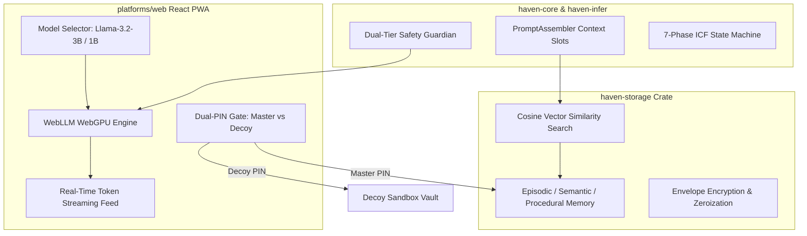

# Sprint 5 Implementation Plan: Real On-Device WebGPU Inference, Vector Memory & Decoy Vault

## Goal Description
Transition Project Haven from simulated dialogue into **real local neural inference and longitudinal vector memory**:
1. **In-Browser WebGPU Model Inference (`@mlc-ai/web-llm`) in [`platforms/web/`](file:///d:/Documents/_MyStuff/Projects/haven-lifecoach/platforms/web)**:
   - Wire the [ModelSelector](file:///d:/Documents/_MyStuff/Projects/haven-lifecoach/platforms/web/src/components/ModelSelector.tsx) to execute 4-bit quantized **`Llama-3.2-3B-Instruct`** (128k context) and **`Llama-3.2-1B-Instruct`** directly inside the browser via WebGPU.
   - Real-time download, cache, and shader compilation progress HUD (`InitProgressCallback`).
   - Token streaming into the dialogue feed with slot-constrained ICF prompt formatting.
   - Graceful zero-error fallback to the Instant Air-Gapped Simulation engine when WebGPU is unavailable or disabled.
2. **On-Device Vector Storage & Semantic Memory Engine in [`haven-storage`](file:///d:/Documents/_MyStuff/Projects/haven-lifecoach/crates/haven-storage)**:
   - Cosine similarity vector search over embedded memory records (384-dim / 768-dim embeddings).
   - Dynamic retrieval of top-$k$ relevant semantic profile values and episodic reflections to populate `PromptAssembler` slots.
   - Crypto-shredding integration: shredding a memory record immediately zeroizes both ciphertext and vector embeddings on flash storage.
3. **Plausible Deniability Decoy Vault & Dual-PIN Authentication**:
   - Master PIN unlocks the real encrypted vault.
   - Decoy PIN unlocks an innocuous, populated decoy instance with generic entries (e.g. routine study schedules or grocery lists) for high-risk / coercive environments.
4. **Changelog & Atomic Commits**:
   - Document in [`CHANGELOG.md`](file:///d:/Documents/_MyStuff/Projects/haven-lifecoach/CHANGELOG.md) under `[0.5.0] - Sprint 5`.
   - Maintain atomic commits on `develop`.

---

## User Review Required

> [!IMPORTANT]
> **WebGPU Model Download Footprint**:
> - `Llama-3.2-3B-Instruct` in 4-bit quantization is approximately **1.9 GB**, while `Llama-3.2-1B-Instruct` is approximately **850 MB**.
> - In browser runtimes, WebLLM caches these model weights permanently inside IndexedDB / Cache API, meaning the download occurs only **once** per device.
> - For instant evaluation without waiting for multi-gigabyte weight downloads, the **Instant Air-Gapped Simulation Engine** remains available at all times as a zero-download default toggle.

> [!NOTE]
> **Decoy Vault UX**:
> The stealth specification requires plausible deniability. If a client is coerced to unlock Haven, entering the **Decoy PIN** displays an innocuous personal organization log rather than their sensitive coaching dialogue.

---

## Open Questions

1. **Default Model on First Launch**:
   - Should first-time visitors default to **Instant Air-Gapped Simulation** (instant zero-download start, allowing them to opt-in to download Llama-3.2-3B via a "Download Local Model" button), or should it immediately prompt them to initialize the 1.9 GB WebGPU model upon first interaction? (Recommended: Default to instant simulation with an opt-in "Load WebGPU Weights" button so users without high-speed internet aren't blocked).
2. **Decoy PIN Preset**:
   - What default secondary PIN should be used for demoing the Decoy Vault? (Recommended: Master PIN `1234`, Decoy PIN `0000`).

---

## Proposed Changes

### Component 1: On-Device Vector Storage & Retrieval ([`crates/haven-storage/`](file:///d:/Documents/_MyStuff/Projects/haven-lifecoach/crates/haven-storage))

#### [MODIFY] [`crates/haven-storage/src/schema.rs`](file:///d:/Documents/_MyStuff/Projects/haven-lifecoach/crates/haven-storage/src/schema.rs)
- Update `CREATE_MEMORY_ITEMS_TABLE` to store serialized embedding vectors.

#### [MODIFY] [`crates/haven-storage/src/storage.rs`](file:///d:/Documents/_MyStuff/Projects/haven-lifecoach/crates/haven-storage/src/storage.rs)
- Implement `insert_memory_with_embedding()`, `search_similar_memories()`, cosine similarity scoring, and embedding zeroization on crypto-shredding.

#### [NEW] [`crates/haven-storage/tests/vector_search_tests.rs`](file:///d:/Documents/_MyStuff/Projects/haven-lifecoach/crates/haven-storage/tests/vector_search_tests.rs)
- Integration test for vector similarity search and crypto-shredding.

---

### Component 2: In-Browser WebGPU WebLLM Client ([`platforms/web/`](file:///d:/Documents/_MyStuff/Projects/haven-lifecoach/platforms/web))

#### [MODIFY] [`platforms/web/package.json`](file:///d:/Documents/_MyStuff/Projects/haven-lifecoach/platforms/web/package.json)
- Add `@mlc-ai/web-llm`.

#### [NEW] [`platforms/web/src/webllm.ts`](file:///d:/Documents/_MyStuff/Projects/haven-lifecoach/platforms/web/src/webllm.ts)
- Engine manager for `@mlc-ai/web-llm`.

#### [NEW] [`platforms/web/src/components/ModelProgressHUD.tsx`](file:///d:/Documents/_MyStuff/Projects/haven-lifecoach/platforms/web/src/components/ModelProgressHUD.tsx)
- Progress bar for model weights download and shader compilation.

#### [MODIFY] [`platforms/web/src/App.tsx`](file:///d:/Documents/_MyStuff/Projects/haven-lifecoach/platforms/web/src/App.tsx)
- Wire WebLLM token streaming and progress HUD.

---

### Component 3: Plausible Deniability Decoy Vault & Dual-PIN Authentication

#### [NEW] [`platforms/web/src/components/VaultAuthModal.tsx`](file:///d:/Documents/_MyStuff/Projects/haven-lifecoach/platforms/web/src/components/VaultAuthModal.tsx)
- PIN unlock dialog for Master PIN (`1234`) and Decoy PIN (`0000`).

#### [MODIFY] [`platforms/web/src/App.tsx`](file:///d:/Documents/_MyStuff/Projects/haven-lifecoach/platforms/web/src/App.tsx)
- Support Decoy Vault state.

---

## Verification Plan

### Automated Tests
1. `cargo test --package haven-storage --test vector_search_tests`
2. `cargo test --workspace`
3. `cd platforms/web; npm run build`
